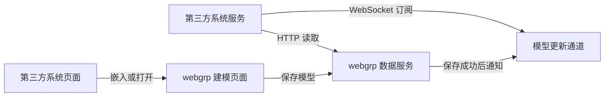
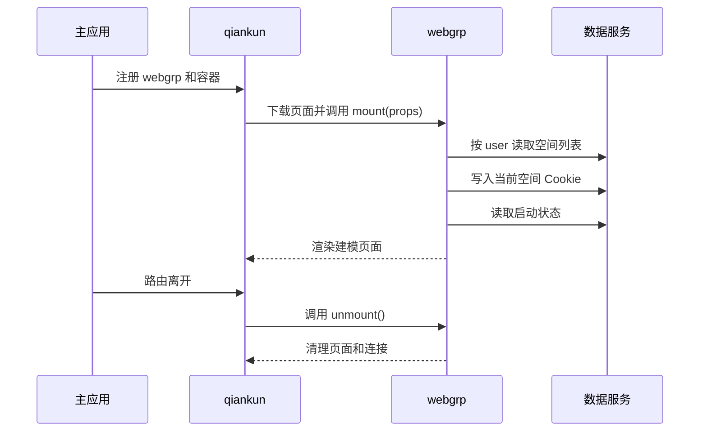
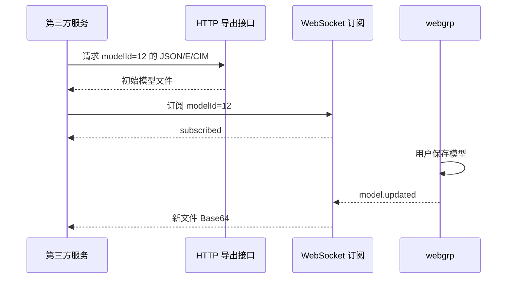

# webgrp 第三方系统接入手册

本文面向第一次接触 webgrp 的前端和后端开发人员，说明如何把 webgrp 接入自己的系统。

本文覆盖三件事：

1. 把 webgrp 的绘图页面放进自己的网页；
2. 由自己的服务主动读取已保存的模型；
3. 订阅模型变化，在模型保存后自动收到更新。

文中把 webgrp 画布称为“建模页面”，把 webgrp 后端称为“数据服务”。

---

## 0. 先了解整体结构

一次完整接入通常包含三个地址：

| 地址 | 用途 | 默认地址 |
|---|---|---|
| 建模页面 | 显示 webgrp 画布 | `http://127.0.0.1:5173` |
| 数据服务 | 保存空间、方案、模型并提供 HTTP 接口 | `http://127.0.0.1:5174` |
| 模型更新通道 | 推送模型保存后的变化 | `ws://127.0.0.1:5174/webgrp/v1/subscriptions/ws` |

默认接口前缀是 `/webgrp`。如果部署时改了前缀，下面所有示例都要同步替换。

### 推荐的系统关系



### 部署前准备

webgrp 运行需要 Node.js 24 或更高版本。

```bash
pnpm install
pnpm dev       # 开发时同时启动页面和数据服务
```

生产环境可以把 `dist/` 作为静态页面托管，把 Node 数据服务单独运行，再用 Nginx、网关或其他反向代理统一对外提供地址。

最重要的配置项：

```json
{
  "frontend": {
    "port": 5173,
    "prefix": "/"
  },
  "backend": {
    "port": 5174,
    "prefix": "/webgrp"
  },
  "dataDir": "./data"
}
```

配置优先级是：环境变量 > `platform.config.json` > 默认值。

| 配置 | 作用 |
|---|---|
| `frontend.prefix` | 建模页面部署在哪个路径，例如 `/modeling/` |
| `frontend.mode` | 导出模式：`backend`（默认）或 `frontend` |
| `backend.prefix` | HTTP 和 WebSocket 接口前缀，默认 `/webgrp` |
| `dataDir` | 模型和配置文件保存位置 |
| `IMAGE_SERVER_HOST` | 数据服务监听地址 |
| `IMAGE_SERVER_PORT` | 数据服务端口 |
| `GRAPH_MODEL_DATA_DIR` | 临时覆盖数据目录，优先级高于配置文件 |
| `GRAPH_MODEL_PROJECT` | 项目配置目录名称；命令行 `--project` 优先 |
| `GRAPH_MODEL_FRONTEND_MODE` | 覆盖 `frontend.mode` |

### 前端导出模式

当 `frontend.mode` 设置为 `frontend` 时，模型导出不请求本项目的后端导出 API。浏览器直接使用共享导出模块生成 CIM/XML、E 文件和 SVG，并使用当前前端页面的 origin 加 API 前缀组装目标地址：

- `${window.location.origin}/webgrp/export/cim`
- `${window.location.origin}/webgrp/export/e`
- `${window.location.origin}/webgrp/export/svg`

例如当前前端网址为 `http://localhost:5173` 时，CIM 地址为 `http://localhost:5173/webgrp/export/cim`。部署使用自定义 API 前缀时，以 `API_PREFIX` 的实际值替换 `/webgrp`；不要使用后端配置的 `host` 或 `backend.port` 替代当前前端 origin。

三个地址均使用 `POST` multipart 请求。

每个请求包含一个文件字段和模型元数据字段：

| 格式 | 文件字段 | 编码 |
|---|---|---|
| CIM/XML | `cim_file` | UTF-8 |
| E 文件 | `e_file` | GBK |
| SVG | `svg_file` | UTF-8 |

通用字段为 `model_id`、`model_name`、`scheme_path`、`format` 和 `sent_at`。接收 URL 由外部系统负责处理，平台只检查 HTTP 状态是否成功；完整字段、文件名、MIME、超时和失败语义见 `docs/FRONTEND-INTERNAL-API-CONTRACT.md` 的 6.9 节。点击保存时，模型保存成功后会自动并行发送这三种产物；目标端点失败不会撤销已经完成的模型保存。

---

## 按项目启动

项目配置放在仓库根目录的 `projects/<项目名称>/platform.config.json`。项目配置可以使用自己的端口、接口前缀和 `dataDir`；相对 `dataDir` 相对该项目目录解析。

```bash
# POSIX
pnpm dev -- --project demo
pnpm server -- --project demo
GRAPH_MODEL_PROJECT=demo pnpm server
```

```powershell
# PowerShell
pnpm dev -- --project demo
pnpm server -- --project demo
$env:GRAPH_MODEL_PROJECT = "demo"
pnpm server
```

命令行 `--project` 优先于 `GRAPH_MODEL_PROJECT`。未指定项目时只读取根目录 `platform.config.json`，不会扫描 `projects/`。指定项目但配置缺失、读取失败、JSON 损坏或内容不是对象时回退根配置；`GRAPH_MODEL_DATA_DIR` 仍然覆盖最终配置中的 `dataDir`。目录结构和示例见 [`projects/README.md`](../projects/README.md)。

---

# 1. 嵌入 webgrp 建模页面

## 1.1 使用 qiankun 嵌入

qiankun 适合已经有主应用、菜单、登录用户和路由的系统。主应用负责决定什么时候显示 webgrp；webgrp 负责画图、保存和读取自己的模型数据。

### 第一步：准备 webgrp

开发环境启动 webgrp：

```bash
cd graph_modeling_platform
$env:VITE_QIANKUN = "true"
pnpm dev
```

生产构建时同样设置 `VITE_QIANKUN=true`：

```bash
VITE_QIANKUN=true pnpm build
```

在 qiankun 模式下，webgrp 会自动完成以下事情：

- 使用相对资源地址，避免脚本和样式找不到；
- 暴露 `bootstrap`、`mount`、`unmount` 三个生命周期；
- 不在自己的入口重复渲染页面；
- 宿主页面切走时停止当前页面。

webgrp 的应用名称是 `graph-modeling-platform`，主应用注册时必须使用完全相同的名称。

### 第二步：主应用注册 webgrp

下面是主应用中的最小示例。主应用可以是 Vue、React 或其他前端框架，qiankun 的注册代码基本相同。

```js
import { registerMicroApps, start } from "qiankun";

let started = false;

export function startWebgrp(projectInfo, userName) {
  if (started) return;
  started = true;

  registerMicroApps([
    {
      name: "graph-modeling-platform",
      entry: "http://127.0.0.1:5173",
      container: "#webgrp-container",
      activeRule: "/modeling",
      props: {
        // 开发时可以填前端地址，因为 Vite 会把 /webgrp 转发到 5174。
        // 生产时建议填能同时访问 /webgrp 和 /webgrp/ws 的统一地址。
        apiBaseUrl: "http://127.0.0.1:5173",
        project: projectInfo,
        schema: "tenant-a",
        user: userName
      }
    }
  ]);

  start({
    sandbox: false,
    prefetch: "all"
  });
}
```

页面容器：

```html
<div id="webgrp-container" style="height: 100vh"></div>
```

### 主应用传入参数

| 参数 | 是否必须 | 作用 |
|---|---:|---|
| `apiBaseUrl` | 推荐 | webgrp 运行时连接数据服务的地址；会把 `http` 转成 `ws` 连接 `/webgrp/ws` |
| `user` | 推荐 | 当前登录用户。webgrp 会据此选择或创建属于该用户的空间 |
| `schema` | 可选 | 主系统的租户或业务范围标识，供宿主和 webgrp 之间传递上下文 |
| `project` | 可选 | 主系统当前项目/作业信息，供页面上下文使用 |
| `container` | qiankun 自动传入 | webgrp 页面要挂载的容器，不需要手工构造 |

`user` 只用于空间归属和页面筛选，不等于服务器端权限。生产系统仍应在网关或数据服务前增加登录认证和权限校验。

### qiankun 启动过程



### qiankun 常见问题

| 现象 | 检查方法 |
|---|---|
| 页面资源 404 | 构建时是否设置 `VITE_QIANKUN=true` |
| 页面显示但接口失败 | `apiBaseUrl` 是否能访问 `/webgrp` 和 `/webgrp/ws` |
| 用户看到别人的空间 | 是否传入 `user`，且 `mount` 先绑定用户空间再启动页面 |
| 切换路由后页面仍在运行 | 主应用是否真正触发 `unmount` |
| 画布高度不满 | 宿主容器和 qiankun 生成的包裹元素是否设置了 `height: 100%` |

## 1.2 不使用 qiankun

不使用 qiankun 时，webgrp 作为一个普通独立页面运行。最稳妥的嵌入方式是 iframe。

### iframe 示例

```html
<iframe
  src="https://webgrp.example.com/modeling/"
  title="电力系统建模"
  style="width: 100%; height: 100vh; border: 0"
></iframe>
```

这种方式没有宿主参数传递，webgrp 会按自己的页面逻辑运行：

- 用户可以使用 webgrp 页面中的空间选择器；
- 当前空间通过 `gmp_space` Cookie 记录；
- 页面自己的运行时连接使用地址栏中的 `?token=`；
- 主应用不能直接读取 webgrp 内部 React 状态。

如果 iframe 和主应用不是同一个站点，优先使用统一域名反向代理。跨站 Cookie 会受浏览器策略影响，不能把“用户空间隔离”建立在跨站 Cookie 一项上。

### 直接打开独立页面

如果不需要把画布放在主页面内部，可以直接跳转：

```js
window.location.href = "https://webgrp.example.com/modeling/";
```

这时 webgrp 完全自己管理页面、空间和连接，接入工作最少。

### 不使用 qiankun 时的参数和返回

此模式没有 `mount(props)` 参数。主应用和 webgrp 的交互通常只有两类：

| 方向 | 方式 | 内容 |
|---|---|---|
| 主应用 → webgrp | URL、Cookie 或反向代理 | 页面地址、空间选择、统一域名 |
| 主应用服务 → webgrp | HTTP / WebSocket | 读取模型和订阅更新 |

### 页面嵌入的请求和返回

qiankun 模式下，主应用发出的“请求”不是 HTTP JSON，而是一次页面挂载调用：

```js
await webgrp.mount({
  container: document.querySelector("#webgrp-container"),
  apiBaseUrl: "https://example.com",
  user: "alice",
  schema: "tenant-a",
  project: { id: "project-1", name: "示例项目" }
});
```

成功时，webgrp 会在容器内显示建模页面，并自行建立到数据服务的连接；失败时由宿主捕获挂载异常或通过页面上的错误提示处理。`mount()` 不返回模型数据，模型数据请使用下一章的 HTTP 接口读取。

不使用 qiankun 时，iframe 的“请求”就是页面地址：

```http
GET https://webgrp.example.com/modeling/
```

成功返回 HTML、脚本和样式，页面随后自行访问 `/webgrp` 数据接口；它不会向宿主页面返回一份业务 JSON。宿主若要拿模型内容，应直接调用模型接口，而不是从 iframe 的页面 DOM 中抓取。

---

# 2. 通过接口主动获取模型数据

## 2.1 推荐接口：批量模型导出

新系统推荐使用：

```http
GET /webgrp/v1/models/export
```

它可以读取一个模型、一个方案，或者整个空间，并一次返回 JSON、SVG、CIM/XML、E 文件中的一种或多种。

### 常用参数

| 参数 | 说明 |
|---|---|
| `scope` | `model`、`scheme` 或 `space`。单模型读取使用 `model` |
| `modelId` | 模型稳定编号，适用于 `scope=model` |
| `schemeId` | 方案稳定编号 |
| `schemePath` | 方案路径 JSON 字符串，需 URL 编码 |
| `name` | 使用方案路径定位模型时的模型名称 |
| `formats` | `json,svg,cim,e` 的逗号列表 |
| `encoding` | `utf-8` 或 `gbk`，默认 `utf-8` |
| `template` | E 文件预定义模板，例如 `国网E格式`、`配网实时库` |
| `mergeE` | 按模型类型生成合并 E 文件 |
| `includeAssociatedModels` | 同时读取关联模型 |
| `colorMode` | SVG 配色：`energy` 或 `voltage` |
| `strict` | CIM 严格校验关键参数 |

### 请求示例：读取单个模型的 JSON、SVG、CIM、E

```http
GET http://127.0.0.1:5174/webgrp/v1/models/export?scope=model&modelId=12&formats=json,svg,cim,e&encoding=utf-8
```

### 请求示例：读取方案及其子方案

```http
GET /webgrp/v1/models/export?scope=scheme&schemePath=%5B%22默认方案%22%5D&formats=json
```

### 返回格式

```json
{
  "ok": true,
  "data": {
    "scope": "model",
    "selectedModelCount": 1,
    "expandedModelCount": 0,
    "modelCount": 1,
    "models": [
      {
        "modelId": 12,
        "schemeId": 3,
        "schemePath": ["默认方案"],
        "name": "厂站一",
        "modelType": "厂站",
        "expandedByAssociation": false,
        "artifacts": [
          {
            "format": "json",
            "encoding": "utf-8",
            "mimeType": "application/json",
            "filename": "厂站一.json",
            "contentBase64": "..."
          }
        ]
      }
    ],
    "mergedE": [],
    "warnings": []
  }
}
```

### 浏览器端解码 JSON

```js
function decodeBase64Utf8(value) {
  const binary = atob(value);
  const bytes = Uint8Array.from(binary, (char) => char.charCodeAt(0));
  return new TextDecoder("utf-8").decode(bytes);
}

const response = await fetch(
  "/webgrp/v1/models/export?scope=model&modelId=12&formats=json"
);
const envelope = await response.json();
if (!envelope.ok) throw new Error(envelope.error.message);

const artifact = envelope.data.models[0].artifacts[0];
const project = JSON.parse(decodeBase64Utf8(artifact.contentBase64));
```

### 关联模型和合并 E

```http
GET /webgrp/v1/models/export?scope=model&modelId=12&formats=e&includeAssociatedModels=true&mergeE=true
```

注意：`mergeE=true` 按 `modelType` 分组。例如同时包含厂站、馈线、台区时，会返回多个独立的合并 E 产物，而不是强行拼成一个文件。

## 2.2 兼容接口：单模型原始导出

以下接口仍可使用，但新系统优先使用上面的批量接口：

```http
GET /webgrp/v1/schemes/model/export?format=json
GET /webgrp/v1/schemes/model/export?format=svg
GET /webgrp/v1/schemes/model/export?format=e-file
GET /webgrp/v1/schemes/model/export?format=cim-xml
```

### JSON 请求和返回

```http
GET /webgrp/v1/schemes/model/export?format=json&schemeId=3&name=厂站一
```

```json
{
  "ok": true,
  "data": {
    "project": {
      "version": 1,
      "name": "厂站一",
      "nodes": [],
      "edges": []
    }
  }
}
```

### SVG、CIM 和 E 文件

这三种格式返回文件内容，不是 JSON 信封：

```http
GET /webgrp/v1/schemes/model/export?format=svg&schemeId=3&name=厂站一&encoding=utf-8
GET /webgrp/v1/schemes/model/export?format=cim-xml&schemeId=3&name=厂站一
GET /webgrp/v1/schemes/model/export?format=e-file&schemeId=3&name=厂站一&template=国网E格式&encoding=gbk
```

| format | 返回类型 | 默认编码 |
|---|---|---|
| `svg` | `image/svg+xml` | UTF-8 |
| `cim-xml` | `application/xml` | UTF-8 |
| `e-file` | `text/plain` | GBK |

旧接口的 GET 响应会带 `Deprecation: true`，并通过 `Link` 响应头指向 `/webgrp/v1/models/export`。

### 自定义 E 模板

预定义模板不能满足需求时，可以使用 POST：

```http
POST /webgrp/v1/schemes/model/export?format=e-file&schemeId=3&name=厂站一&encoding=gbk
Content-Type: application/json

{
  "templateText": "<Model>...模板内容...</Model>",
  "templateName": "第三方模板"
}
```

返回 `text/plain` 的 E 文件内容。

## 2.3 空间选择和错误

第三方服务不应依赖浏览器 Cookie，建议明确传入：

```text
?space=default
```

也可以使用请求头：

```http
X-Space: default
```

常见错误：

| HTTP | code | 说明 |
|---:|---|---|
| 400 | `bad-request` | 参数缺失、格式错误或组合不允许 |
| 404 | `not-found` | 方案或模型不存在 |
| 500 | `internal` | 读取文件或生成文件失败 |

---

# 3. 按需订阅模型更新

## 3.1 连接地址

模型更新订阅不是普通 HTTP 请求，而是 WebSocket 连接：

```text
ws://127.0.0.1:5174/webgrp/v1/subscriptions/ws?space=default
```

HTTPS 部署时使用 `wss://`。

WebSocket 连接关闭后，订阅会被清理；重新连接后必须重新发送订阅请求。

## 3.2 订阅请求

客户端发送 JSON 文本：

```json
{
  "type": "subscribe",
  "scope": {
    "type": "model",
    "modelId": 12
  },
  "files": [
    { "kind": "json", "encoding": "utf-8" },
    { "kind": "xml", "encoding": "utf-8" },
    { "kind": "e", "encoding": "gbk" }
  ]
}
```

### 订阅范围

| `scope.type` | 说明 |
|---|---|
| `space` | 当前空间内所有模型 |
| `scheme` | 指定方案及其子方案，需要 `schemePath` |
| `model` | 一个模型，需要正整数 `modelId` |

### 文件类型

| kind | 说明 |
|---|---|
| `json` | 模型原始 JSON |
| `xml` | CIM/XML；推送消息中的 `kind` 为 `cim` |
| `e` | E 文件 |

目前不支持通过订阅请求传入自定义 E 模板。

## 3.3 订阅成功响应

```json
{
  "type": "subscribed",
  "ok": true,
  "data": {
    "subscriptionId": "sub-123",
    "scope": {
      "type": "model",
      "modelId": "12"
    },
    "files": [
      { "kind": "json", "encoding": "utf-8" },
      { "kind": "xml", "encoding": "utf-8" },
      { "kind": "e", "encoding": "gbk" }
    ]
  }
}
```

## 3.4 模型更新响应

模型成功保存后，客户端会收到：

```json
{
  "type": "model.updated",
  "data": {
    "model_id": "12",
    "model_name": "厂站一",
    "template_name": "",
    "scheme_path": "[\"默认方案\"]",
    "sent_at": "2026-11-22T10:00:00.000Z",
    "files": [
      {
        "kind": "json",
        "field": "json_file",
        "filename": "厂站一.json",
        "contentType": "application/json; charset=utf-8",
        "encoding": "utf-8",
        "bytes": 1234,
        "contentBase64": "..."
      },
      {
        "kind": "cim",
        "field": "cim_file",
        "filename": "厂站一.xml",
        "contentType": "application/xml; charset=utf-8",
        "encoding": "utf-8",
        "bytes": 2345,
        "contentBase64": "..."
      }
    ]
  }
}
```

订阅只在模型已经成功保存后触发。尚未保存的画布修改不会推送。一次保存可能包含多个文件，但同一个订阅只收到一条更新消息。

## 3.5 浏览器完整示例

```js
const spaceId = "default";
const ws = new WebSocket(
  `ws://127.0.0.1:5174/webgrp/v1/subscriptions/ws?space=${encodeURIComponent(spaceId)}`
);

ws.addEventListener("open", () => {
  ws.send(JSON.stringify({
    type: "subscribe",
    scope: { type: "model", modelId: 12 },
    files: [
      { kind: "json", encoding: "utf-8" },
      { kind: "xml", encoding: "utf-8" },
      { kind: "e", encoding: "gbk" }
    ]
  }));
});

ws.addEventListener("message", (event) => {
  const message = JSON.parse(event.data);
  if (message.type === "subscribed") {
    console.log("订阅成功", message.data.subscriptionId);
    return;
  }
  if (message.type === "model.updated") {
    for (const file of message.data.files) {
      const binary = atob(file.contentBase64);
      const bytes = Uint8Array.from(binary, (char) => char.charCodeAt(0));
      console.log(file.filename, file.bytes, bytes.length);
    }
    return;
  }
  if (message.type === "error") {
    console.error(message.error.code, message.error.message);
  }
});
```

## 3.6 取消订阅和错误

取消：

```json
{
  "type": "unsubscribe",
  "subscriptionId": "sub-123"
}
```

成功：

```json
{
  "type": "unsubscribed",
  "ok": true,
  "data": { "subscriptionId": "sub-123" }
}
```

错误示例：

```json
{
  "type": "error",
  "error": {
    "code": "not-found",
    "message": "订阅目标不存在。",
    "subscriptionId": "sub-123"
  }
}
```

## 3.7 HTTP 快照 + WebSocket 更新

WebSocket 订阅本身不会自动发送完整的初始模型。常用做法是先用 HTTP 读取一次，再用 WebSocket 接收后续变化：



---

## 3.8 Node.js 和 Python 客户端封装

仓库提供 `clients/node` 和 `clients/python` 两套客户端。两者都保存期望订阅，连接断开后自动重连，并在连接恢复后重新发送订阅。服务端不重放离线消息，因此应在恢复回调中重新读取 HTTP 快照。

Node.js：

```bash
pnpm --dir clients/node install
```

Node 客户端当前是仓库内私有包，不从公共包仓库安装；外部项目可把 `clients/node`
作为本地依赖，或直接导入 `clients/node/src/index.mjs`。

```js
import { ModelUpdateClient } from "./clients/node/src/index.mjs";

const client = new ModelUpdateClient({
  url: "ws://127.0.0.1:5174/webgrp/v1/subscriptions/ws",
  space: "default",
  onResynchronized: async () => {
    // 重新 GET 当前模型快照
  }
});
client.on("model.updated", (data) => console.log(data.model_id));
await client.connect();
await client.subscribe({
  scope: { type: "model", modelId: 12 },
  files: [{ kind: "json" }, { kind: "e", encoding: "gbk" }]
});
```

Python：

```bash
python -m pip install -e clients/python
```

```python
from model_update_client import ModelUpdateClient

client = ModelUpdateClient(
    "ws://127.0.0.1:5174/webgrp/v1/subscriptions/ws",
    space="default",
    on_resynchronized=lambda _client: print("重新读取 HTTP 快照"),
)
client.on("model.updated", lambda data: print(data["model_id"]))
client.connect()
client.subscribe(
    {"type": "model", "modelId": 12},
    [{"kind": "json"}, {"kind": "e", "encoding": "gbk"}],
)
```

两端都把关闭码 `4003`（空间已删除）视为永久失败；`close()` 会停止自动重连。完整示例分别位于 `clients/node/examples/basic.mjs` 和 `clients/python/examples/basic.py`。

# 4. 第三方服务部署和反向代理

## 4.1 推荐的统一入口

生产环境建议让第三方系统通过一个域名访问：

```text
https://example.com/modeling/       建模页面
https://example.com/webgrp/...      HTTP 接口
wss://example.com/webgrp/...        WebSocket
```

这样浏览器不需要跨站 Cookie，空间选择也更容易保持一致。

## 4.2 Nginx 示例

下面的示例把建模页面放到 `/modeling/`，把数据服务放到 `/webgrp/`：

```nginx
server {
    listen 443 ssl;
    server_name example.com;

    location /modeling/ {
        alias /srv/webgrp/dist/;
        try_files $uri $uri/ /modeling/index.html;
    }

    location /webgrp/ {
        proxy_pass http://127.0.0.1:5174;
        proxy_http_version 1.1;
        proxy_set_header Host $host;
        proxy_set_header X-Real-IP $remote_addr;
        proxy_set_header Upgrade $http_upgrade;
        proxy_set_header Connection "upgrade";
    }
}
```

对应的 `platform.config.json`：

```json
{
  "frontend": { "prefix": "/modeling/" },
  "backend": { "prefix": "/webgrp", "port": 5174 }
}
```

反向代理必须允许 WebSocket 升级，否则 HTTP 接口正常但订阅连接会失败。

## 4.3 空间和权限

当前 webgrp 的空间选择是“请求上下文选择”，不是登录鉴权：

1. `X-Space` 请求头；
2. `?space=` 查询参数；
3. `gmp_space` Cookie；
4. 回退到首个空间。

第三方服务调用时，建议始终显式传 `?space=<空间ID>` 或 `X-Space`。生产系统还应在反向代理或业务服务中增加登录、权限和空间授权，不能只依赖 `user` 参数或 Cookie。

---

# 5. 接入检查清单

## 页面嵌入

- [ ] 已确定使用 qiankun 或 iframe；
- [ ] qiankun 模式下应用名称为 `graph-modeling-platform`；
- [ ] qiankun 构建设置了 `VITE_QIANKUN=true`；
- [ ] 宿主传入了正确的 `apiBaseUrl` 和 `user`；
- [ ] 建模容器有明确高度；
- [ ] 页面静态资源和 `/webgrp/` 接口路径都能访问。

## 主动读取

- [ ] 已确认空间 ID；
- [ ] 单模型读取优先使用 `/webgrp/v1/models/export?scope=model`；
- [ ] 已处理 Base64 解码和 GBK 字节；
- [ ] 已处理 400、404、500 错误；
- [ ] 如果使用旧单模型 GET，已记录它处于兼容状态。

## 更新订阅

- [ ] 首次读取已通过 HTTP 完成；
- [ ] WebSocket 地址使用 `ws` 或 `wss`；
- [ ] 订阅消息包含合法范围和文件类型；
- [ ] 处理了 `subscribed`、`model.updated`、`error`；
- [ ] 断线后会重新连接并重新订阅；
- [ ] 反向代理允许 WebSocket 升级；
- [ ] 已处理 GBK E 文件的解码。
