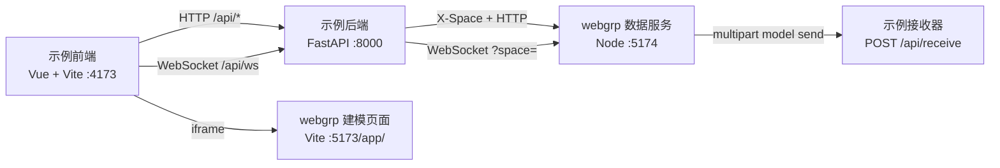

# webgrp 接入示例

这是一个可以直接运行的 webgrp 接入案例。它模拟“其他业务系统”同时拥有自己的前端和后端，并把 webgrp 作为被集成的建模能力接入。

案例重点不是重新实现 webgrp，而是把接入方需要发送的请求、webgrp 返回的内容、WebSocket 事件和页面嵌入关系直接展示出来。

## 案例实现了什么

- 用 iframe 和 qiankun 两种方式在宿主页面中嵌入真实 webgrp 建模页面；
- 用 FastAPI 后端代理 webgrp HTTP API，避免前端直接处理跨域和服务地址；
- 读取方案树、图元库、在线客户端和模型导出结果；
- 调用模型发送接口，把 JSON、SVG、E、CIM 文件发送到示例接收器；
- 用 FastAPI WebSocket 桥连接 webgrp 模型更新通道；
- 在浏览器中显示请求 URL、请求体、响应状态、响应 JSON 和 WebSocket 原始帧；
- 展示断线、上游不可用、订阅确认、取消订阅和模型更新等接入状态；
- 提供 iframe、Python HTTP、Python WebSocket 和恢复快照的可复制配方。

## 整体实现



### 前端如何实现

前端是独立的 Vue 3 + Vite 项目，入口在 `frontend/src/App.vue`，按接入场景分为四个面板：

| 面板 | 作用 | 主要文件 |
| --- | --- | --- |
| 嵌入预览 | iframe / qiankun 模式切换、空间语义和自适应缩放 | `frontend/src/components/EmbedPanel.vue` |
| HTTP API | 构造代理请求并显示响应 | `frontend/src/components/HttpExplorer.vue` |
| WebSocket | 连接 FastAPI 桥，发送订阅帧并显示事件 | `frontend/src/components/WebsocketMonitor.vue` |
| 接入配方 | 生成 HTML、Python HTTP、Python WS 代码 | `frontend/src/components/RecipePanel.vue` |

iframe 模式只需要示例前端的 `/api/*` 代理；qiankun 模式还需要宿主代理 `/webgrp/*` 到 webgrp 的 `5174` 服务。开发时 `frontend/vite.config.ts` 把 `/api` 和 `/api/ws` 代理到 `http://127.0.0.1:8000`，把 `/webgrp` 和 `/webgrp/ws` 代理到 `http://127.0.0.1:5174`。

iframe 不附加 `?space=`。webgrp 页面继续使用自己的 `gmp_space` Cookie；示例后端的 HTTP 请求使用 `X-Space`，WebSocket 请求使用 `?space=`。

嵌入预览支持两种模式：

- **iframe 直接嵌入**：适合快速接入、跨构建链部署或只需要展示独立页面的系统；
- **qiankun 微前端**：通过 `loadMicroApp` 加载 webgrp 的 `bootstrap/mount/unmount` 生命周期，向 webgrp 传入 `apiBaseUrl`、`schema`、`user` 和 `project`。

两种模式都使用 `1440 × 810` 的基准画布。宿主容器通过 `ResizeObserver` 监听尺寸，按 `min(容器宽 / 1440, 容器高 / 810)` 计算比例，并对画布进行 CSS transform 缩放。容器变大时允许放大，变小时自动缩小，页面会显示当前缩放比例且不会产生横向溢出。

qiankun 模式启用了实验性样式隔离，并让宿主使用独立的 `.integration-shell` 类名。嵌入期间示例还会恢复宿主 `html/body` 的滚动和背景样式，并跳过 webgrp 首次新手引导。webgrp 内部的新手引导通过 `portalElement=".app-shell"` 定位，如果宿主也使用 `.app-shell`，浮层会误挂到宿主页面，造成遮罩和弹层布局错乱。

### 后端如何实现

FastAPI 代码位于 `backend/app/`：

| 文件 | 职责 |
| --- | --- |
| `config.py` | 读取 webgrp 页面、HTTP、WebSocket、空间和接收器地址 |
| `webgrp_client.py` | 使用 `httpx` 调用 webgrp HTTP API，设置 `X-Space` 并记录请求摘要 |
| `log_store.py` | 保存最多 200 条有界请求/事件时间线，避免完整模型内容撑爆页面 |
| `main.py` | FastAPI 路由、模型接收器和浏览器到 webgrp 的 WebSocket 桥 |

后端的 HTTP 路由映射如下：

| 示例后端路由 | 实际 webgrp 调用 |
| --- | --- |
| `GET /api/webgrp/schemes` | `GET /webgrp/v1/schemes`，透传 `view`、`includeProjects`、`schemePath`、`schemeId` |
| `GET /api/webgrp/library` | `GET /webgrp/v1/library?part=...` |
| `GET /api/webgrp/runtime/clients` | `GET /webgrp/v1/runtime/clients` |
| `GET /api/webgrp/models/export` | `GET /webgrp/v1/models/export`，只透传允许的查询参数 |
| `POST /api/webgrp/send` | `POST /webgrp/v1/schemes/model/send`，透传模型定位、目标 URL、文件格式/编码和 E 模板 |
| `POST /api/receive` | 接收 webgrp 发来的 multipart，并只保留字段摘要 |

WebSocket 桥的方向是：

```text
浏览器 ws://127.0.0.1:4173/api/ws?space=default
    ↓
FastAPI /api/ws
    ↓
webgrp ws://127.0.0.1:5174/webgrp/v1/subscriptions/ws?space=default
```

浏览器发送 `subscribe`、`unsubscribe` 等 JSON 文本帧，FastAPI 原样转发；webgrp 返回 `subscribed`、`unsubscribed`、`model.updated`、`error` 等帧，再由 FastAPI 转发回浏览器。模型文件内容以 Base64 传输，页面只展示文件名、编码、字节数和摘要。

## 运行前提

这个案例依赖真实 webgrp 服务，因此需要先启动根项目的 webgrp。

---

## 接入内容清单

下面是案例中实际展示的接入内容：

- Vue 3 + Vite 前端工作台；
- FastAPI 后端代理；
- iframe 嵌入 webgrp 页面；
- 后端读取方案、图元库、在线客户端和模型导出；
- `POST /webgrp/v1/schemes/model/send` 发送到示例接收器；
- FastAPI 到 `/webgrp/v1/subscriptions/ws` 的 WebSocket 双向桥；
- 原始请求、响应、订阅确认和模型更新事件的可视化查看。

## 先启动 webgrp

在仓库根目录启动真实的 webgrp。iframe 模式直接启动即可：

```powershell
pnpm install
pnpm dev
```

如果要在示例中切换到 qiankun 模式，需要让 webgrp 以 qiankun 子应用方式启动：

```powershell
$env:VITE_QIANKUN = "true"
pnpm dev
```

qiankun 模式要求 webgrp 的入口暴露 `graph-modeling-platform` 生命周期；如果没有设置 `VITE_QIANKUN=true`，示例会在 qiankun 面板中显示启动错误，并给出重新启动提示。

默认地址：

| 地址 | 作用 |
| --- | --- |
| `http://127.0.0.1:5173/app/` | webgrp 建模页面，供 iframe 预览 |
| `http://127.0.0.1:5174` | webgrp 数据服务 |
| `ws://127.0.0.1:5174/webgrp/v1/subscriptions/ws` | 模型更新订阅 |

如果 webgrp 使用了其他端口或 API 前缀，先设置后端环境变量。

## 启动示例后端

PowerShell：

```powershell
cd examples/webgrp-integration-demo/backend
python -m venv .venv
.venv\Scripts\python.exe -m pip install -r requirements.txt
.venv\Scripts\python.exe -m uvicorn app.main:app --reload --host 127.0.0.1 --port 8000
```

也可以在示例目录运行：

```powershell
./run-backend.ps1
```

后端配置通过环境变量覆盖：

```powershell
$env:WEBGRP_HTTP_BASE_URL = "http://127.0.0.1:5174"
$env:WEBGRP_FRONTEND_URL = "http://127.0.0.1:5173/app/"
$env:WEBGRP_WS_BASE_URL = "ws://127.0.0.1:5174"
$env:WEBGRP_API_PREFIX = "/webgrp"
$env:WEBGRP_SPACE = "default"
$env:DEMO_RECEIVER_URL = "http://127.0.0.1:8000/api/receive"
```

后端地址：

- `http://127.0.0.1:8000/docs`：FastAPI OpenAPI 文档；
- `http://127.0.0.1:8000/api/health`：健康检查；
- `http://127.0.0.1:8000/api/config`：前端工作台使用的连接配置。

## 启动示例前端

```powershell
cd examples/webgrp-integration-demo/frontend
pnpm install
pnpm dev --host 127.0.0.1 --port 4173
```

或者：

```powershell
cd examples/webgrp-integration-demo
./run-frontend.ps1
```

打开 `http://127.0.0.1:4173`。

开发模式下 Vite 会把 `/api` 和 `/api/ws` 代理到 `http://127.0.0.1:8000`，因此浏览器不需要直接跨域访问 webgrp。FastAPI 同时保留 CORS，方便直接打开构建后的静态页面。

## 页面里的四条演示路径

### 1. 嵌入预览

“嵌入预览”提供 iframe 和 qiankun 两个 tab。iframe 遵循 webgrp 自身的 `gmp_space` Cookie 选择，不拼接 `?space=`；qiankun 则把宿主用户通过 `props.user` 传给 webgrp，由 webgrp 的生命周期处理用户空间绑定。

当宿主系统已有微前端平台时，推荐参考 qiankun 配方。生产环境建议使用统一域名反向代理，或者把 webgrp 按仓库内的 qiankun 方式注册到主应用。

qiankun 的核心调用形态：

```ts
loadMicroApp({
  name: "graph-modeling-platform",
  entry: "http://127.0.0.1:5173/app/",
  container: "#webgrp-container",
  props: {
    apiBaseUrl: "http://127.0.0.1:4173",
    schema: "integration-demo",
    user: "integration-demo-user",
    project: { id: "webgrp-integration-demo", name: "webgrp 接入示例" }
  }
});
```

### 2. HTTP API

工作台中的 HTTP 面板只调用 FastAPI，FastAPI 会对 webgrp HTTP 请求设置 `X-Space: default`（或环境变量中的空间），避免把 `space` 当成某些统一入口不接受的查询参数：

```text
浏览器 → GET /api/webgrp/schemes → FastAPI → GET /webgrp/v1/schemes
```

请求构造器会按当前接口显示完整可编辑参数，并将同一份参数用于“执行请求”和“复制请求”：

- 方案树：可编辑 `view=summary|hierarchy|models`、`includeProjects`，以及 models 视图的 `schemeId/schemePath`；
- 图元库：可编辑 `part=all|categories|devices|measurements|device-definitions|templates`；
- 在线客户端：无查询参数；
- 批量模型导出：可编辑 `scope`、模型/方案定位、`formats`、`encoding`、`includeDescendants`、`mergeE`、`includeAssociatedModels`、`colorMode`、`strict` 和 `template`；
- 模型发送：可编辑 `modelId` 或 `schemeId/schemePath + name`、目标 `url`、每个文件的 `kind/encoding` 和 `templateName`。

模型发送目标默认填入示例后端的 `/api/receive`，也可以在请求构造器中修改。接收器只保留字段名、文件名、字节数和 24 字节 Base64 预览，适合重复联调；修改目标后请确认目标服务可信。

### 3. WebSocket 订阅

浏览器连接示例后端：

```text
ws://127.0.0.1:4173/api/ws?space=default
```

FastAPI 再连接 webgrp：

```text
ws://127.0.0.1:5174/webgrp/v1/subscriptions/ws?space=default
```

订阅帧示例：

```json
{
  "type": "subscribe",
  "requestId": "demo-1",
  "scope": { "type": "space" },
  "files": [
    { "kind": "json", "encoding": "utf-8" },
    { "kind": "e", "encoding": "gbk" }
  ]
}
```

面板会显示 `bridge.ready`、`upstream.connected`、`subscribed`、`model.updated` 和 `error`。模型更新中的文件内容由 webgrp 以 Base64 提供，面板展示文件名、编码、字节数和原始 JSON，不把完整文件塞进时间线。

桥接不会自动重连。断开后点击“重新连接”，再发送一次订阅，并用 HTTP API 重新读取当前快照。webgrp 的订阅通道不重放离线期间的更新。

### 4. 接入配方

配方页会根据 `/api/config` 动态生成：

- iframe 嵌入 HTML；
- qiankun `loadMicroApp` 嵌入代码；
- Python `httpx` 读取模型；
- Python WebSocket 订阅；
- 断线恢复后的 HTTP 快照读取。

仓库还提供正式的 Node/Python 订阅客户端：

- `clients/node`：适合 Node 服务，内置自动重连和恢复订阅；
- `clients/python`：适合 Python 服务，使用后台线程自动重连。

## 构建和检查

前端生产构建：

```powershell
cd examples/webgrp-integration-demo/frontend
pnpm build
```

后端语法检查：

```powershell
python -m compileall -q examples/webgrp-integration-demo/backend/app
```

## 目录结构

```text
examples/webgrp-integration-demo/
├── backend/
│   ├── app/main.py             # FastAPI 路由和 WS 桥
│   ├── app/config.py           # 环境变量配置
│   ├── app/log_store.py        # 有界内存时间线
│   └── app/webgrp_client.py    # HTTP / WS 上游地址和 HTTP 代理
├── frontend/
│   ├── src/App.vue             # 工作台壳层
│   ├── src/components/         # 四个演示面板
│   ├── src/composables/        # API 调用封装
│   └── src/styles.css          # 视觉令牌、网格和响应式布局
├── run-backend.ps1
├── run-frontend.ps1
└── README.md
```

## 案例更新时的文档同步要求

`README.md` 是这个案例的接入说明入口。以后修改案例时，代码和文档必须在同一次变更中同步更新，不能只改页面或接口而留下旧说明。

至少检查以下内容：

- 新增、删除或修改 FastAPI 路由时，更新“后端 HTTP 路由映射”和请求示例；
- 修改 WebSocket 帧、事件名称、订阅范围或恢复行为时，更新 WebSocket 流程和 JSON 示例；
- 修改环境变量、默认端口、API 前缀或 webgrp 前端路径时，更新环境变量表、启动命令和默认地址；
- 修改前端面板、按钮或接入场景时，更新“案例实现了什么”、面板职责和配方说明；
- 修改目录、模块职责或启动脚本时，更新目录结构和运行步骤；
- 完成更新后至少执行前端构建和后端语法检查，并把验证命令保留在本节或“构建和检查”一节。

推荐的更新顺序：先改代码，再对照代码更新 README，最后执行 `pnpm build` 和 `python -m compileall -q examples/webgrp-integration-demo/backend/app`。如果接入契约发生变化，还应同步检查根目录的 `docs/WEBGRP-INTEGRATION-GUIDE.md`。
